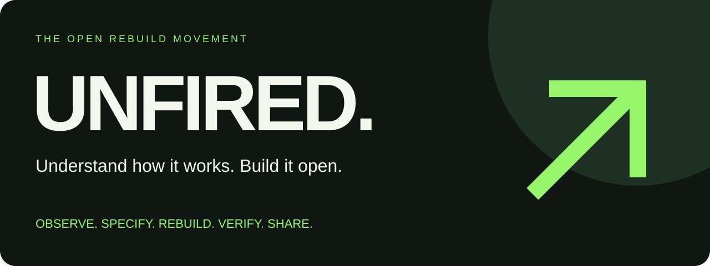

<div align="center">



# UNFIRED

**They ended your role. You keep your skills.**

A free, open-source survival kit for layoffs — and a movement to turn hard-earned skills into tools everyone can use.

[Start here](docs/01-first-72-hours.md) · [Learn](docs/04-learning-paths.md) · [Build](projects/README.md) · [Contribute](CONTRIBUTING.md) · [Share](community/launch-kit.md)


</div>

## Your next move starts here

Losing a job can take away income, routine, and confidence at once. You do not have to solve your whole future today. Start with the next useful step.

| Your situation | Start with | Leave with |
| --- | --- | --- |
| “It just happened.” | [First 72 hours](docs/01-first-72-hours.md) | A short checklist for benefits, documents, support, and deadlines |
| “How much time do I have?” | [Runway and income](docs/02-runway-and-income.md) | A cash-flow scenario and a realistic weekly plan |
| “I need another job.” | [Job-search playbook](docs/03-job-search.md) | A targeted resume, outreach scripts, and a private tracker |
| “What should I learn?” | [Learning paths](docs/04-learning-paths.md) | A four-week track with tangible deliverables |
| “I want to build something free.” | [Build playbook](docs/05-build-free-alternatives.md) | A small, independently implemented product people can use |
| “I want to help without coding.” | [Contributing](CONTRIBUTING.md) | Documentation, testing, research, design, or translation work |

## The movement

Workers carry years of experience. That experience can power public goods: free utilities, open formats, portable data, and understandable software. Our answer to feeling disposable is to build things people can keep.

AI is changing work, and some workers face displacement. Layoffs have many causes; this project does not assume every layoff was caused by AI or promise any skill is “AI-proof.” Use AI where it helps, verify its output, and keep human judgment in charge.

**Recover. Learn. Build. Share. Repeat.**

Read [the manifesto](community/manifesto.md), follow [the flexible 90-day plan](docs/09-90-day-plan.md), or use [the skills-to-tools worksheet](docs/10-skills-to-tools.md) to choose a first project.

We welcome workers whether they want a job, freelance income, a cooperative, a business, or simply time to recover. No one owes the internet a comeback story.

## Run something useful today

Python 3.10+; no packages, account, API key, paid model, or network required.

```bash
# Make a private workspace with editable trackers and a weekly plan.
python3 tools/unfired.py init

# Estimate a simple cash runway. Use one currency throughout.
python3 tools/unfired.py runway --cash 9000 --monthly-costs 2500 --monthly-income 500 --reserve 1000

# Clean a synthetic CSV: normalize headers, trim cells, remove duplicate rows.
python3 tools/unfired.py csv-clean examples/messy-contacts.csv --out output/clean-contacts.csv

# Summarize your private job-search tracker without publishing company/contact details.
python3 tools/unfired.py report .unfired/applications.csv --out output/search-summary.md

# Verify tools, data, and local documentation links.
python3 -m unittest discover -s tests -v
python3 scripts/check_repo.py
```

See [tool usage and limitations](tools/README.md). `.unfired/` and `output/` are ignored by Git. Keep personal records there; review staged changes before every public push.

## What is ready, and what is next?

**Ready:** recovery guides, learning tracks, reusable templates, local trackers, a runway calculator, a CSV cleaner, an aggregate tracker report, and community contribution workflows.

**Proposed:** the [project catalog](projects/catalog.json) contains 12 scoped ideas. The CSV cleaner has an initial implementation here; the other entries are proposals, not finished products. There are no claimed users, partners, savings, or adoption numbers.

**Free source is not free hosting.** Local tools run without a subscription; managed hosting, storage, domains, support, and optional AI APIs can cost money. See [sustainability](docs/07-community-and-sustainability.md).

## Build from your skills

Use public documentation, public standards, properly licensed dependencies, and original implementations. Do not contribute employer code, internal designs, private prompts, customer data, credentials, or confidential knowledge. A clean implementation is a contribution rule, not a guarantee that every product is legally clear. See [provenance and independent development](docs/06-independent-development.md).

## Join in one small step

- Improve one instruction that confused you.
- Test the CSV cleaner with synthetic data and report a reproducible issue.
- Propose one narrowly scoped tool after talking to potential users.
- Translate the first-72-hours guide and have a second speaker review it.
- Share the repo with one person who would find it useful.

Use the [issue templates](.github/ISSUE_TEMPLATE), [contribution guide](CONTRIBUTING.md), and [launch kit](community/launch-kit.md). This is an early project with [a public roadmap](ROADMAP.md), not an established support organization. We cannot promise response times.

## License and publication

[MIT](LICENSE) covers original code, documentation, templates, and artwork in this repository. Anyone, including companies, may use and modify them commercially while preserving the required notice. MIT does **not** require downstream modifications to stay open. Linked third-party materials keep their own licenses.

The name is a working project name; availability and trademark clearance have not been established. [Publish to GitHub](docs/08-publish-and-launch.md) after reviewing the contents. Publication and viral reach are not guaranteed.

Employment, benefits, immigration, tax, and IP rules depend on location and circumstances. Guides point to official sources; they are general information, not individualized professional advice. Source review date: **2026-10-27**.
